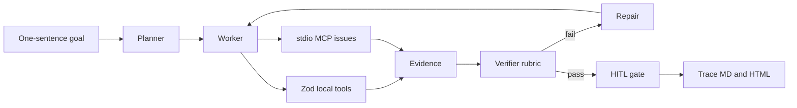

# ForgeFlow

ForgeFlow turns one sentence into a checkable tool workflow.

**Judged sentence:** a planner maps that sentence onto local Zod tools and an MCP issue server, the worker drafts a PR, the verifier rejects the first draft on purpose, one repair passes, and the trace shows the evidence.

## Problem

A fluent PR can still be ungrounded. It can skip the README, cite no issues, and claim the change has zero risk without a tool ever saying that. Judges are left trusting the prose.

ForgeFlow makes that failure visible, then repairs it from tool output only. The first `draft_pr` is an intentional gap: no README quote, no issue numbers, a checklist that says "Ship it", and an unsupported claim. One repair drafts again from the tool corpus. The verifier accepts a claim only when it is an exact substring of tool output. High-severity issues must be cited. The checklist must cover tests, docs, risk, and rollback.

Do not remove the first-draft failure. The judge path expects `repairs=1`.

## Judge path

Node 20 or newer and pnpm. No API key. Stay offline.

```bash
pnpm install
pnpm test
pnpm demo:mock
pnpm eval
```

`pnpm demo` is the same mock run as `pnpm demo:mock`. On stdout, in this order: `intentional draft-pr FAIL`, `repair 1`, `repairs=1`, `verdict pass`. The run also writes [artifacts/last-run.md](artifacts/last-run.md) and [artifacts/last-run.html](artifacts/last-run.html). Open the HTML for the camera. The sticky header is **verdict pass**. The banner reads FAIL → repair 1 → PASS.

Full 3-minute camera script: [DEMO.md](DEMO.md).

## 给评委

评分只看离线 mock，不要调用 OpenAI。

```bash
pnpm install
pnpm demo:mock
```

终端应按这个顺序出现 `intentional draft-pr FAIL`、`repair 1`、`repairs=1`、`verdict pass`。然后打开 `artifacts/last-run.html`，顶栏是 verdict pass。

核对规则：修复后的 claim 必须是工具输出的原样子串；高严重度 issue `#12` 和 `#18` 必须被引用；清单必须覆盖 tests、docs、risk、rollback。第一次失败是故意的，不要把它修掉。`pnpm test` 和 `pnpm eval` 是另外两项离线检查。`pnpm demo:live` 会访问 `api.openai.com`，在中国大陆等地可能被地理封锁，不作为评分路径。

## Architecture



| Role | What the mock does |
| --- | --- |
| Planner | `createPlan` assigns an ordered workflow. Every step is tagged `local` or `mcp`. |
| Worker | Runs the plan. Local tools use Zod. Issue tools go through a stdio MCP server spawned with a scrubbed environment. |
| Verifier | Scores the draft against tool output. Coverage is an exact substring, not a paraphrase. |
| Repair | Re-drafts once from the README quote and the MCP issue records. Attempt 1 stays an intentional fail. |
| HITL | Approves a passing draft. `FORGEFLOW_HITL=deny` or `--hitl deny` rejects it. |

Mock mode never calls the network. Issues come from [fixtures/issues.json](fixtures/issues.json). No GitHub token.

## Verifier

| Check | Passes when |
| --- | --- |
| `title` | Names the audit and the README |
| `summary-quote` | Backtick quote of at least 24 characters copied from `read_readme` |
| `issue-citations` | Every high-severity open issue is cited, and every cited number was returned by a tool |
| `checklist-gates` | The checklist contains tests, docs, risk, and rollback |
| `evidence-map` | The map names a successful local call and a successful mcp call |
| `coverage` | Every claim is an exact substring of the tool corpus |
| `no-gap` | The intentional-gap marker is gone |

The fixture's high-severity issues are `#12` and `#18`. `#27` is medium and is listed with the other open issues, but the gate is the high-severity pair.

## OpenAI tools and MCP

| Piece | Mock judge path | Live path |
| --- | --- | --- |
| Planner | `createPlan` assigns steps and `local` / `mcp` kinds | Same tools, model follows `LIVE_INSTRUCTIONS` |
| Local tools | Zod schemas: `read_readme`, `list_files`, `draft_pr` | `@openai/agents` `tool()` with the same schemas |
| Issue tools | stdio MCP: `list_open_issues`, `get_issue` | `MCPServerStdio` pointed at `pnpm exec tsx src/mcp-server/index.ts` |
| Verifier | Rubric + exact-substring coverage | Instructions ask the model to cite tool output |
| Repair | One deterministic re-draft | Not scripted; mock owns the fail-then-repair beat |
| HITL | Auto-approve after a pass. `FORGEFLOW_HITL=deny` or `--hitl deny` rejects | SDK `needsApproval` is available; the mock gate is the demo |
| Trace | `artifacts/last-run.md` and `.html` | Model text on stdout |

SDK pin: `@openai/agents` 0.21. The server is [src/mcp-server/index.ts](src/mcp-server/index.ts).

## Live mode and geography

`pnpm demo:live` calls `api.openai.com`. OpenAI geo-blocks that API from mainland China and some other networks, so a live call can fail even with a valid key. Do not put a key in the repo. Copy [.env.example](.env.example) to `.env` locally if you have a key. Judges should score `pnpm demo:mock`.

Optional knobs, all unset on the scored path:

- `pnpm demo:mock -- --hitl deny` rejects a draft that already passed the rubric. Exit code 1 is expected.
- `FORGEFLOW_MAX_REPAIRS` is an integer from 0 to 4. The default is 2, which leaves room for the one repair the judge path needs.
- A typo in `FORGEFLOW_MODE`, `FORGEFLOW_HITL`, or `FORGEFLOW_MAX_REPAIRS` exits 2 instead of silently changing the demo.

## MCP server

```bash
pnpm exec tsx src/mcp-server/index.ts
```

Spawn that command for a client. It speaks MCP on stdin/stdout and writes nothing else to stdout. `pnpm mcp` runs the same file, but pnpm's own script banner is not protocol-safe, so clients should use `pnpm exec`. Tools:

- `list_open_issues` `{ repo }` — open issues from the fixture. `repo` is a label; the fixture is the only issue set.
- `get_issue` `{ repo, number }` — one issue, or an error if the number is unknown.

The mock worker spawns this same entry with `tsx` and a scrubbed environment. The child does not receive `OPENAI_API_KEY`.

## Layout

`src/agent` plans, works, verifies, and repairs. `src/tools` holds Zod local tools and the MCP bridge. `src/verify` is the rubric and coverage check. `src/cli.ts` is the judge entry. `evals/cases` holds the golden workflow plus regressions that fail a draft missing rollback, citing issue `#999`, or adding an unsupported claim.
